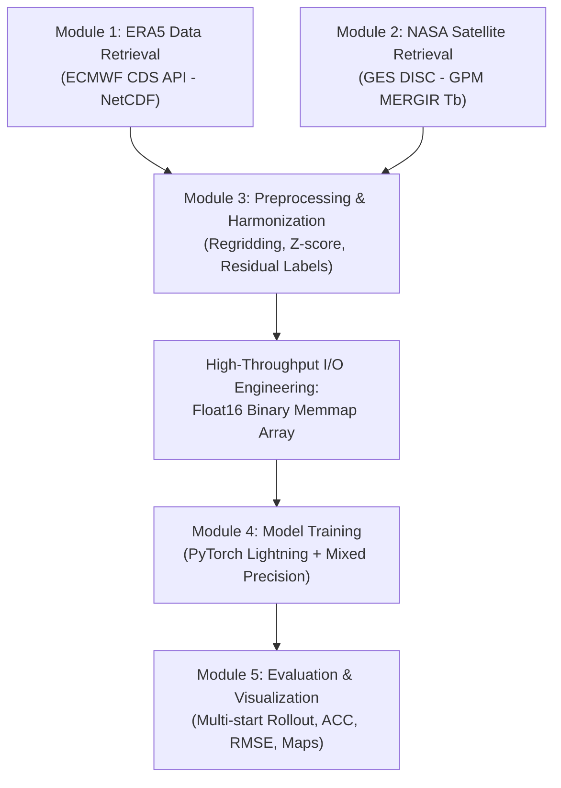

# ERA5 & NASA Satellite Data Pipeline

> Data extraction workflows, preprocessing, strict anti-leakage normalization protocols, and high-performance memory engineering (Float16 Memory-Mapped Arrays).

<div class="toc-card">
  <div class="toc-title">📑 Table of Contents</div>
  <ol>
    <li><a href="#pipeline-5-module">1. Five-Module Pipeline Architecture</a></li>
    <li>
      <a href="#data-sources">2. Detailed Data Sources</a>
      <ol>
        <li><a href="#era5-brain">2.1. ECMWF ERA5 Branch (The "Brain" Branch)</a></li>
        <li><a href="#satellite-eye">2.2. NASA GPM MERGIR Satellite Branch (The "Eye" Branch)</a></li>
      </ol>
    </li>
    <li>
      <a href="#preprocessing-and-normalization">3. Preprocessing & Normalization Workflow</a>
      <ol>
        <li><a href="#spatiotemporal-alignment">3.1. Spatial and Temporal Harmonization</a></li>
        <li><a href="#anti-leakage">3.2. Strict Anti-Leakage Normalization Protocol</a></li>
      </ol>
    </li>
    <li><a href="#float16-memmap">4. Memory Optimization: Float16 Binary Memmap</a></li>
  </ol>
</div>

---

## 1. Five-Module Pipeline Architecture :id=pipeline-5-module

The data processing system of WeatherForecast-SEA is organized into five highly decoupled and reproducible modules:



---

## 2. Detailed Data Sources :id=data-sources

### 2.1. ECMWF ERA5 Branch (The "Brain" Branch) :id=era5-brain
- **Retrieval Method:** Queries the Copernicus Climate Data Store using `cdsapi`.
- **Temporal Chunking:** Pressure levels are partitioned into semi-annual batches to adhere to CDS API download quotas.
- **Surface Variables:**
  - `t2m`: 2-meter air temperature (Kelvin).
  - `d2m`: 2-meter dewpoint temperature (Kelvin); paired with `t2m` to quantify near-surface relative humidity.
  - `u10`, `v10`: 10-meter eastward and northward wind components (m/s).
  - `msl`: Mean sea level pressure (Pascal) — key diagnostic marker for tropical cyclone centers and monsoon troughs.
  - `tp`: Total accumulated precipitation over the preceding 6 hours (meters).
- **Upper-Air Pressure Levels:**
  - **850 hPa (~1,500 m):** Positioned immediately above the planetary boundary layer, tracking monsoon moisture transport.
  - **500 hPa (~5,500 m):** Mid-troposphere level dictating tropical cyclone steering flows.
  - Variables: Geopotential $z$ ($m^2/s^2$), specific humidity $q$ (kg/kg), zonal wind $u$, and meridional wind $v$ (m/s).
- **Static Invariant Fields:**
  - Land-sea mask (`lsm`) and surface geopotential (`geopotential_surf`).

### 2.2. NASA GPM MERGIR Satellite Branch (The "Eye" Branch) :id=satellite-eye
- **Physical Characteristics:** MERGIR (Merged Geostationary Infrared) synthesizes thermal infrared brightness temperature from international geostationary satellites (Himawari-8, GOES-East/West, Meteosat).
- **Native Resolution:** $4\text{ km} \times 4\text{ km}$, 30-minute sampling interval.
- **Meteorological Insights:**
  - Clear-sky conditions: Sensitometer detects warm land/ocean skin temperatures $\to$ High $T_b$ ($> 280\text{ K}$).
  - Deep convective towers: Cloud tops penetrate toward the tropopause $\to$ Ultra-cold cloud-top temperatures ($T_b < 210\text{ K}$).
  - Serves as the observational ground truth to compensate for numerical parameterization biases in ERA5 precipitation (`tp`).

---

## 3. Preprocessing & Normalization Workflow :id=preprocessing-and-normalization

### 3.1. Spatial and Temporal Harmonization :id=spatiotemporal-alignment
1. **Temporal Filtering:** Subsamples satellite passes to precisely match the synoptic timesteps: $00, 06, 12, 18\text{ UTC}$.
2. **Spatial Interpolation:** Applies conservative Bilinear Interpolation from the native $4\text{ km}$ satellite grid to the standard atmospheric $0.25^\circ$ grid.
3. **Namespace Collision Prevention:** Renames the surface geopotential to `geopotential_surf` to prevent collision with upper-air geopotential fields `z` at 850/500 hPa.

### 3.2. Strict Anti-Leakage Normalization Protocol :id=anti-leakage
In meteorological machine learning, data leakage via normalization statistics across temporal splits is a critical pitfall:
- All statistical parameters (Mean $\mu$ and Standard Deviation $\sigma$) are computed strictly and exclusively on the **5-year training split (2020–2024)**.
- Validation (2025) and test splits (2026) are normalized using the frozen $\mu_{train}, \sigma_{train}$:
  $$\tilde{x} = \frac{x - \mu_{train}}{\sigma_{train}}$$
- Single-step residual prediction labels are formulated as:
  $$\Delta \mathbf{X}(t) = \tilde{\mathbf{X}}(t+1) - \tilde{\mathbf{X}}(t)$$

---

## 4. Memory Optimization: Float16 Binary Memmap :id=float16-memmap

### Problem Formulation
Kaggle Notebooks and shared GPU clusters enforce strict constraints of 30 GB disk and 13–16 GB RAM. When operating on compressed Zarr archives:
- Every training epoch repeatedly decompresses thousands of small chunk blocks.
- Host CPU bottlenecks emerge, with I/O wait times consuming up to 70% of total training wall-clock time.
- Frequent Out-Of-Memory (OOM) memory spikes abruptly terminate training jobs.

### Technical Solution
The project implements a **One-time Float16 Pre-decode to Memory-mapped Binary Arrays** strategy:
1. Decompresses the dataset once into contiguous flat binary `.npy` arrays on local NVMe disk, cast to `np.float16`.
2. At runtime, the PyTorch DataLoader maps the file via `np.memmap(..., mode='r')`.
3. The operating system Kernel Page Cache directly streams memory pages into host RAM with zero decompression overhead.

```
┌────────────────────────────────────────────────────────┐
│            PERFORMANCE IMPACT OF MEMMAP I/O            │
├────────────────────────────────────────────────────────┤
│ • Training Wall-Clock Time: Reduced from ~11h to ~6h   │
│ • Out-of-Memory Errors: Completely eliminated (0 OOM)  │
│ • Effective I/O Throughput: ~8x increase               │
│ • Scaling Efficiency: Seamless multi-GPU execution     │
└────────────────────────────────────────────────────────┘
```
