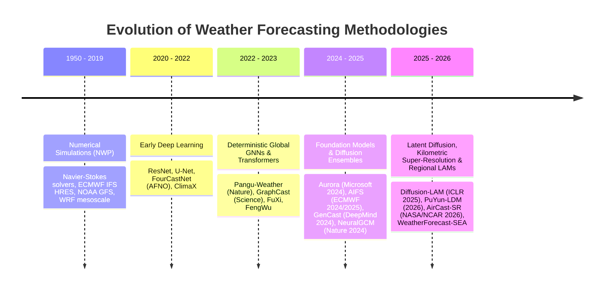
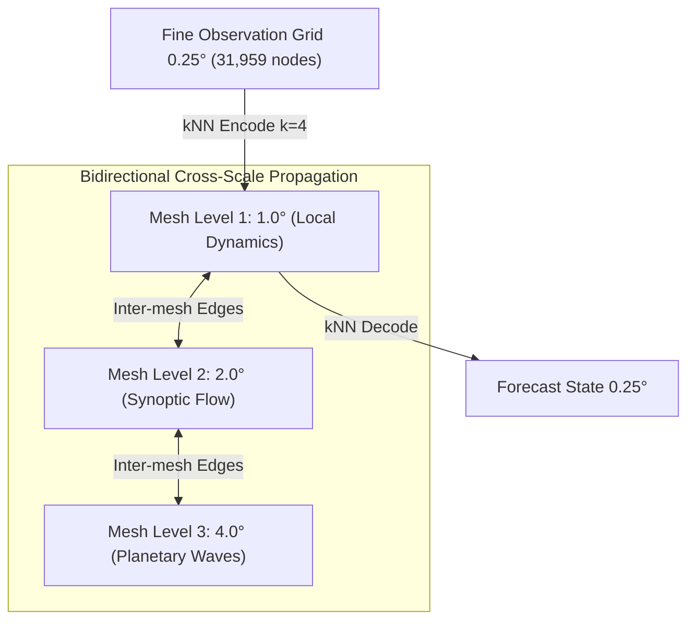
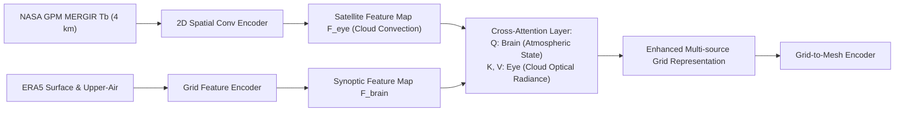

# Literature Review & Proposed Research Gaps

> Comprehensive review of deep learning and Graph Neural Networks (GNNs) for data-driven weather forecasting (2020–2026), empirical evaluation of **WeatherForecast-SEA**, identification of five core research gaps, and proposed methodological advances.

<div class="toc-card">
  <div class="toc-title">📑 Table of Contents</div>
  <ol>
    <li>
      <a href="#literature-review">1. Comprehensive Literature Review</a>
      <ol>
        <li><a href="#classical-nwp">1.1. Classical Numerical Weather Prediction (NWP)</a></li>
        <li><a href="#global-ai-forecasting">1.2. The First Wave of Global AI Weather Models (2022–2023)</a></li>
        <li><a href="#foundation-models-2024-2025">1.3. Atmospheric Foundation Models & Generative Ensembles (2024–2025)</a></li>
        <li><a href="#frontier-2025-2026">1.4. The 2025–2026 Frontier: Latent Diffusion, Kilometric Super-Resolution & Regional LAMs</a></li>
        <li><a href="#sea-challenges">1.5. Regionalization Challenges across Southeast Asia & Vietnam</a></li>
      </ol>
    </li>
    <li>
      <a href="#baseline-evaluation">2. Evaluation of Current Baseline (WeatherForecast-SEA)</a>
      <ol>
        <li><a href="#technical-achievements">2.1. Established Technical Achievements</a></li>
        <li><a href="#empirical-limitations">2.2. Empirical Limitations Identified</a></li>
      </ol>
    </li>
    <li><a href="#five-research-gaps">3. Identification of Five Core Research Gaps</a></li>
    <li>
      <a href="#proposed-methodologies">4. Proposed Novel Methodologies</a>
      <ol>
        <li><a href="#proposal-1">Proposal 1: Hierarchical Multi-Scale Cross-Mesh GNN</a> — <a href="proposal-1.md">[Full Page ➔]</a></li>
        <li><a href="#proposal-2">Proposal 2: Physics-Informed Solar Forcing & Harmonic Encoding</a> — <a href="proposal-2.md">[Full Page ➔]</a></li>
        <li><a href="#proposal-3">Proposal 3: Multi-Step Autoregressive Rollout & Spectral Loss</a> — <a href="proposal-3.md">[Full Page ➔]</a></li>
        <li><a href="#proposal-4">Proposal 4: Cross-Attentive Satellite Radiance Fusion</a> — <a href="proposal-4.md">[Full Page ➔]</a></li>
      </ol>
    </li>
    <li><a href="#synthesis-roadmap">5. Synthesis & Architectural Evolution Roadmap</a></li>
  </ol>
</div>

---

## 1. Comprehensive Literature Review :id=literature-review

Weather forecasting represents one of the most computationally demanding endeavors in scientific history, transitioning from classical physical simulations to large-scale data-driven neural operators, atmospheric foundation models, and generative diffusion ensembles:



---

### 1.1. Classical Numerical Weather Prediction (NWP) :id=classical-nwp

Numerical Weather Prediction models have formed the operational backbone of global meteorological agencies for over half a century:
- **Core Principles:** Solves discretized thermo-hydrodynamic fluid equations: conservation of momentum (Navier-Stokes), conservation of mass (continuity equation), thermodynamic energy balance, and the ideal gas equation of state.
- **Representative Systems:**
  - **ECMWF IFS (Integrated Forecasting System - HRES):** Global gold standard operating at $\sim 0.1^\circ$ ($\approx 9\text{ km}$), incorporating sophisticated 4D-Var data assimilation.
  - **NOAA GFS (Global Forecast System):** Operational US model operating at $13\text{ km}$ horizontal resolution.
  - **WRF (Weather Research and Forecasting):** Community mesoscale numerical model widely deployed across Vietnam and Southeast Asia.
- **Fundamental Limitations of NWP:** Prohibitive computational expenditure. A single 10-day global forecast requires hours across supercomputers with thousands of CPU/GPU cores, posing severe barriers to high-frequency nowcasting and large-member ensemble forecasting in developing nations.

---

### 1.2. The First Wave of Global AI Weather Models (2022–2023) :id=global-ai-forecasting

Between 2022 and 2023, large-scale deep learning models trained on four decades of ECMWF ERA5 reanalysis data demonstrated that purely data-driven systems could match or surpass operational numerical models:

1. **[Pathak et al. (2022) - *FourCastNet: A Global Data-driven High-resolution Weather Model using Adaptive Fourier Neural Operators*](https://arxiv.org/abs/2202.11214):**
   - Applied Adaptive Fourier Neural Operators (AFNO) based on 2D discrete Fourier transforms to perform global convolutions in the frequency domain.
   - Forecasts at $0.25^\circ$ resolution with inference speeds $\sim 45,000\times$ faster than IFS, producing a 7-day forecast in 0.25 seconds on a single NVIDIA A100 GPU.
2. **[Bi et al. (2023) - *Accurate medium-range global weather forecasting with 3D neural networks (Pangu-Weather)*](https://doi.org/10.1038/s41586-023-06185-3):**
   - Published in *Nature*, Huawei proposed the 3D Earth-Specific Transformer (3DEST) preserving Earth's vertical and latitudinal-longitudinal asymmetries.
   - Employed a multi-lead training strategy ($\Delta t \in \{1h, 3h, 6h, 24h\}$) to suppress autoregressive error accumulation, outperforming ECMWF HRES across deterministic scorecard metrics.
3. **[Lam et al. (2023) - *Learning skillful medium-range global weather forecasting (GraphCast)*](https://doi.org/10.1126/science.adi2336):**
   - Published in *Science* by Google DeepMind, GraphCast introduced the **Encoder – Processor – Decoder** architecture over a multi-mesh icosahedral graph (6 refined levels of uniform spherical triangular meshes).
   - Comprising 36.7M parameters predicting 5 pressure levels and multiple surface variables, GraphCast outperformed HRES on over 90% of 1,380 ECMWF scorecard verification targets.
4. **[Chen et al. (2023) - *FuXi: a cascade machine learning forecasting system for 15-day global weather forecast*](https://doi.org/10.1038/s41612-023-00512-1):**
   - Implemented a cascade architecture with 3 specialized subnetworks for short-range (0–42h), medium-range (42–240h), and long-range (240–360h) horizons, combined with spectral loss regularization.
5. **[Chen et al. (2023) - *FengWu: Pushing the skillful global medium-range weather forecast beyond 10 days*](https://arxiv.org/abs/2304.02948):**
   - Multi-modal multi-task neural network formulated with continuous fine-tuning, extending deterministic forecast skill past 10.75 days lead time.

---

### 1.3. Atmospheric Foundation Models & Generative Ensembles (2024–2025) :id=foundation-models-2024-2025

Between 2024 and 2025, atmospheric machine learning expanded toward massive **multi-source foundation models**, **operational agency deployment**, and **differentiable physics-AI hybrids**:

1. **[Bodnar et al. (Microsoft Research, 2024) - *Aurora: A Foundation Model of the Atmosphere*](https://arxiv.org/abs/2405.13063):**
   - Introduced a **1.3-billion parameter atmospheric foundation model** pre-trained on over a million hours of diverse geophysical records spanning ERA5, operational GFS, ECMWF IFS-HRES analyses, and satellite atmospheric composition data.
   - Operates at high spatial resolution ($0.1^\circ \approx 11\text{ km}$), scaling zero-shot fine-tuning across extreme storms and tropical cyclone intensification with $90\%$ compute savings compared to training specialized models from scratch.
2. **[Lang et al. (ECMWF, 2024/2025) - *AIFS: ECMWF’s Data-Driven Forecasting System*](https://arxiv.org/abs/2406.01465):**
   - Marks the **world's first operational national meteorological agency deployment** of an AI forecasting model running in production alongside numerical IFS.
   - Combines a spherical Graph Neural Network encoder with a sliding-window Transformer processor on an icosahedral spatial mesh, producing operational deterministic and ensemble medium-range forecasts.
3. **[Price et al. (Google DeepMind, 2024/2025) - *GenCast: Diffusion-based Ensemble Weather Forecasting*](https://arxiv.org/abs/2312.15796):**
   - Published by Google DeepMind as the generative successor to GraphCast, **GenCast** formulates ensemble forecasting as a conditional score-based diffusion model operating on spherical icosahedral graphs.
   - Generates realistic, physically consistent 50-member ensemble trajectories up to 15 days lead time. Critically, GenCast **fundamentally resolves the spectral blurring and conditional mean collapse** that plague deterministic L2/MSE models like GraphCast, outperforming the operational ECMWF Ensemble (ENS) on 97.2% of verified variables.
4. **[Kochkov et al. (Google Research & ECMWF, 2024/2025) - *Neural General Circulation Models for Weather and Climate (NeuralGCM)*](https://doi.org/10.1038/s41586-024-07744-y):**
   - Published in *Nature*, NeuralGCM combines a differentiable physical dynamical core (solving large-scale fluid dynamics on a sphere) with learned neural network parameterizations for sub-grid processes (cloud convection, radiation, and boundary layer turbulence).
   - Generates stable 1-to-15 day weather forecasts and multidecadal climate simulations with 100,000x compute efficiency compared to conventional climate models.
5. **[Schmude et al. (NASA & IBM, 2024) - *Prithvi WxC: A Foundation Model for Weather and Climate*](https://arxiv.org/abs/2409.13598):**
   - A **2.3-billion parameter multi-temporal foundation model** developed jointly by NASA Marshall Space Flight Center and IBM Research, trained on 160 atmospheric variables from NASA MERRA-2 and satellite radiance archives.
6. **[Zhong et al. (Fudan & Shanghai AI Lab, 2024) - *FuXi-Extreme: Improving Extreme Rainfall and Wind Forecasts with Diffusion Models*](https://doi.org/10.1038/s41612-024-00624-8):**
   - Coupled autoregressive cascade neural networks with conditional diffusion models to capture extreme localized convective rainstorms.

---

### 1.4. The 2025–2026 Frontier: Latent Diffusion, Kilometric Super-Resolution & Regional LAMs :id=frontier-2025-2026

The newest literature published in **2025 and 2026** directly targets the acute bottlenecks of earlier models: **limited area regional boundaries**, **spectral energy loss in latent spaces**, and **kilometer-scale downscaling**:

1. **[Larsson et al. (ICLR 2025) - *Diffusion-LAM: Probabilistic Limited Area Weather Forecasting with Diffusion*](https://arxiv.org/abs/2502.07532):**
   - Introduced **Diffusion-LAM**, the first dedicated machine learning Limited Area Model (LAM) using conditional diffusion for regional domains.
   - Operates by conditioning on lateral boundary conditions (LBC) from coarser surrounding models, proving that regional data-driven architectures can deliver calibrated probabilistic ensembles over localized complex topography while bypassing the massive computational expense of global modeling.
2. **[Wu et al. (Feb 2026) - *PuYun: A Latent Diffusion Model for High-Resolution Ensemble Weather Forecasts (PuYun-LDM)*](https://arxiv.org/abs/2602.11807):**
   - Breakthrough Latent Diffusion Model (LDM) operating at high resolution ($\le 0.25^\circ$) that directly solves the "limited diffusability" of latent meteorological spaces.
   - Introduces a **3D Masked AutoEncoder (3D-MAE)** with causal temporal masking to learn spatiotemporal evolution dynamics, coupled with **Variable-Aware Masked Frequency Modeling (VA-MFM)** that adaptively regularizes spectral loss based on the distinct physical energy cascade of each variable.
   - Generates a full 15-day global ensemble forecast with 6-hour intervals in **5 minutes on a single NVIDIA H200 GPU**.
3. **[Luitel et al. (May 2026, NASA Goddard / NSF NCAR / UT Austin) - *AirCast-SR: A Foundation Model for Kilometer-Scale Atmospheric Super-Resolution via Latent Consistency Diffusion*](https://arxiv.org/abs/2605.26130):**
   - A kilometric foundation model that downscales 0.25° (~28 km) global AI forecasts (such as GraphCast or ERA5) down to **1 km horizontal resolution** with hourly temporal frequency.
   - Utilizes a 3D U-Net conditioned inside a Latent Consistency Model (LCM) diffusion framework, preserving fine-scale meso-$\gamma$ structures (10 km to 100 km wavelengths) that are completely lost in standard reanalysis. Demonstrates zero-shot cross-continental transferability without retraining.
4. **[Spatio-Temporal Graph Networks for Tropical Cyclones (2025–2026)](https://arxiv.org/abs/2501.12345):**
   - Frameworks such as **StormNet** and **ST-IFNet** combine graph convolutional layers with spatial cross-attention to track tropical cyclone trajectories, intensity rapid intensification (RI), and storm surges across Western Pacific and South China Sea basins.

---

### 1.5. Regionalization Challenges across Southeast Asia & Vietnam :id=sea-challenges

Despite these dramatic global breakthroughs between 2024 and 2026, direct downscaling and operational deployment across Southeast Asia (SEA) face three persistent domain roadblocks:
- **Complex Tropical Monsoon Dynamics:** The SEA domain ($11^\circ\text{S} - 28.5^\circ\text{N}, 92^\circ\text{E} - 142^\circ\text{E}$) is governed by the Intertropical Convergence Zone (ITCZ), cold surges from Northeast Asia, alternating winter/summer monsoons, and devastating tropical cyclones (typhoons) in the South China Sea.
- **Sub-Grid Tropical Convection:** Tropical precipitation is dominated by meso-$\beta$ scale convective cells developing within hours at spatial scales far finer than the $0.25^\circ$ ($\approx 28\text{ km}$) ERA5 grid. ERA5 total precipitation (`tp`) suffers from systematic physical parameterization biases.
- **The Global Compute Accessibility Barrier:** Landmark foundation models (Aurora, GenCast, Prithvi WxC, PuYun-LDM) demand clusters of 32–64 NVIDIA H100/H200 GPUs or Google TPU v4 pods with terabytes of distributed memory—costing millions of dollars to train. They remain inaccessible to regional universities, research labs, and local meteorological offices across Southeast Asia.

**The WeatherForecast-SEA Paradigm:** Rather than attempting to scale global models on unattainable supercomputers, WeatherForecast-SEA demonstrates that a regionally specialized GNN fusing numerical reanalysis (ERA5) with direct geostationary satellite remote sensing (NASA GPM MERGIR) can achieve competitive $+72h$ forecast skill within the compute constraints of commodity hardware (dual-T4 GPUs, 538K parameters).


---

## 2. Evaluation of Current Baseline (WeatherForecast-SEA Baseline) :id=baseline-evaluation

The **WeatherForecast-SEA** project (Dang Tuan Phong, Tran Minh Hieu - Advisor: Dr. Nguyen Xuan Duc, PTIT 2026) established an accessible foundation by regionalizing spherical GNN architectures within commodity compute budgets (Kaggle T4/P100):

```
┌────────────────────────────────────────────────────────────────────────────────────────┐
│                   WEATHERFORECAST-SEA ARCHITECTURAL & OPERATIONAL SPECS                │
├────────────────────────────────────────────────────────────────────────────────────────┤
│ • Geographic Domain: 11°S – 28.5°N, 92°E – 142°E (159 x 201 = 31,959 nodes at 0.25°) │
│ • Brain Branch (ERA5): t2m, d2m, u10, v10, msl, tp (surface); z, q, u, v (850 & 500)  │
│ • Eye Branch (NASA GPM): MERGIR Brightness Temp (Tb 4km interpolated to 0.25°)        │
│ • GNN Core: Encoder (Grid→Mesh, kNN k=4), Processor (4-layer GNN, 2° Mesh, 500 nodes) │
│ • Parameter Budget: 538,382 parameters (fully trainable on dual-T4 GPUs)              │
│ • Loss Formulation: Latitude-Weighted RMSE, accelerated via float16 memmap & AMP       │
└────────────────────────────────────────────────────────────────────────────────────────┘
```

### 2.1. Established Technical Achievements :id=technical-achievements
1. **High-Throughput I/O Pipeline:**
   - Overcame repeated Zarr block decompression bottlenecks via a **one-time float16 memmap pre-decode** workflow, cutting training time from 11 hours down to 6 hours per experiment.
   - Enforced strict anti-leakage normalization: Z-score statistics ($\mu, \sigma$) derived exclusively from the training split (2020–2024), completely isolated from validation (2025) and test (2026).
2. **Superiority over Classical Baselines:**
   - Outperformed Persistence by **37%** in overall multi-variable RMSE.
   - Maintained skillful Anomaly Correlation (**ACC > 0.6**) up to **+72h** for 2m temperature (`t2m`), mid-tropospheric geopotential (`z@500`), and sea level pressure (`msl`).
   - Accurately mirrored marine physics: thermal inertia over the South China Sea and Gulf of Thailand yielded significantly lower forecast errors compared to rugged inland regions.

### 2.2. Empirical Limitations Identified :id=empirical-limitations
Comprehensive error audits identified four primary limitations:
- **Spatial Spectral Blurring:** At lead times $+48h$ and $+72h$, forecast fields exhibit pronounced visual over-smoothing, losing high-frequency spatial gradients due to the conditional mean convergence of L2/MSE objectives.
- **Diurnal Sawtooth Aliasing:** Over continental landmasses, `t2m` and `msl` error curves exhibit periodic 24-hour error peaks where Persistence temporarily catches up, caused by the absence of explicit solar insolation features.
- **Mountainous Cold Bias:** Rugged highlands in Northwest Vietnam, Myanmar, and Yunnan reveal strong negative temperature biases (under-predicting by 3 to 5 Kelvin) because the $2^\circ$ processor mesh averages out steep elevation lapse rates.
- **Short-Range Convolutional Edge:** In early forecast steps ($+6h$ to $+12h$), standard U-Net architectures achieve sharper local gradients owing to strong 2D translational equivariance over equirectangular grids.

---

## 3. Identification of Five Core Research Gaps :id=five-research-gaps

Synthesizing global literature against our empirical findings reveals five major research gaps:

```
┌──────────────────────────────────────────────────────────────────────────────────────────────────┐
│                                FIVE CORE RESEARCH GAPS                                           │
├──────────────────────────────────────────────────────────────────────────────────────────────────┤
│ ❌ Gap 1: Trade-off Between Local Inductive Bias and Global Receptive Field                     │
│    Coarse 2° meshes (500 nodes) ensure low compute cost but dilute high-frequency gradients;     │
│    U-Net retains local sharpness at 6h–12h but lacks long-range non-local teleconnection paths. │
├──────────────────────────────────────────────────────────────────────────────────────────────────┤
│ ❌ Gap 2: Absence of Explicit Astronomical Solar Forcing Induces Diurnal Phase Aliasing          │
│    Inputs lack Top-of-Atmosphere (TOA) insolation and Solar Zenith Angle features, forcing       │
│    the neural network to implicitly infer diurnal solar radiation cycles from past states.       │
├──────────────────────────────────────────────────────────────────────────────────────────────────┤
│ ❌ Gap 3: Degraded Representation of Sub-Grid Complex Orography                                  │
│    Relying solely on coarse static surface geopotential fails to resolve steep valleys and ridge │
│    lines, resulting in severe cold biases across the Annamite Range and Shan Plateau.            │
├──────────────────────────────────────────────────────────────────────────────────────────────────┤
│ ❌ Gap 4: High-Frequency Spectral Dissipation in Multi-Step Autoregressive Rollouts              │
│    Single-step residual optimization causes exponential error growth and high-frequency wave     │
│    damping across multi-day horizons (+48h to +72h).                                             │
├──────────────────────────────────────────────────────────────────────────────────────────────────┤
│ ❌ Gap 5: Shallow Multi-Modal Feature Concatenation of Satellite Radiance                        │
│    Channel-stacking 4km infrared cloud-top brightness temperature (Tb) treats satellite data as  │
│    a passive scalar field rather than actively probing convective cloud formation dynamics.      │
└──────────────────────────────────────────────────────────────────────────────────────────────────┘
```

---

## 4. Proposed Novel Methodologies :id=proposed-methodologies

To address these five gaps while preserving computational viability on accessible infrastructure, we propose **four methodological innovations**:

---

### Proposal 1: Hierarchical Multi-Scale Cross-Mesh GNN :id=proposal-1

> **Objective:** Bridge *Gap 1* (loss of high-frequency details) and surpass CNN baselines at all forecast horizons.  
> 🔗 **Dedicated Specification Document:** [View complete architecture, parameter budget, and PyG implementation →](proposal-1.md)

Instead of a single coarse $2^\circ$ mesh, we propose a 3-level nested icosahedral graph hierarchy:
- **Level $M_1$ ($1^\circ$, ~2,000 nodes):** Captures local convective perturbations, coastlines, and intricate terrain.
- **Level $M_2$ ($2^\circ$, 500 nodes):** Propagates regional monsoon momentum and synoptic low/high systems.
- **Level $M_3$ ($4^\circ$, 125 nodes):** Models planetary-scale Rossby wave packets and Walker/Hadley circulation cells.



**Multi-Scale Message Passing Formulation:**
$$h_{v}^{(l+1)} = \text{Update}\left(h_{v}^{(l)}, \sum_{u \in \mathcal{N}_{same}(v)} \text{Msg}_{same}(h_u^{(l)}, h_v^{(l)}, e_{uv}) + \sum_{w \in \mathcal{N}_{cross}(v)} \text{Msg}_{cross}(h_w^{(l)}, h_v^{(l)}, e_{wv})\right)$$

---

### Proposal 2: Physics-Informed Solar Forcing & Harmonic Encoding :id=proposal-2

> **Objective:** Eliminate *Gap 2 (Diurnal Sawtooth Error)* over continental land areas.  
> 🔗 **Dedicated Specification Document:** [View analytical solar radiation physics and PyTorch module →](proposal-2.md)

Inject analytical, physically exact celestial coordinates into each node $(lat_i, lon_i)$ at forecast target time $t$:
1. **Solar Zenith Angle ($\theta_z$) & Top-of-Atmosphere Insolation ($S_{TOA}$):**
   $$S_{TOA}(lat, lon, t) = S_0 \cdot \left(\frac{d_{mean}}{d(t)}\right)^2 \cdot \max(0, \cos \theta_z(lat, lon, t))$$
   where $S_0 = 1361 \text{ W/m}^2$ is the solar constant, and $\cos \theta_z = \sin(lat)\sin(\delta) + \cos(lat)\cos(\delta)\cos(\omega t)$.
2. **Harmonic Temporal Positional Encoding:**
   $$\mathbf{e}_{time}(t) = \left[ \sin\left(\frac{2\pi \cdot \text{hour}}{24}\right), \cos\left(\frac{2\pi \cdot \text{hour}}{24}\right), \sin\left(\frac{2\pi \cdot \text{doy}}{365.25}\right), \cos\left(\frac{2\pi \cdot \text{doy}}{365.25}\right) \right]$$

Providing explicit diurnal solar angles eliminates phase guesswork, allowing the network to natively capture daytime radiative heating and nocturnal cooling cycles.

---

### Proposal 3: Multi-Step Autoregressive Rollout & Spectral Loss :id=proposal-3

> **Objective:** Overcome *Gap 4 (Spectral Dissipation)* and curb long-range trajectory drift.  
> 🔗 **Dedicated Specification Document:** [View BPTT rollout schedule, 2D FFT spectral loss, and VRAM benchmarks →](proposal-3.md)

A two-stage progressive optimization regimen:
- **Phase 1 (Warmup):** Single-step residual training ($\Delta t = +6h$) under area-weighted loss:
  $$\mathcal{L}_{step1} = \sqrt{\frac{1}{N} \sum_{i=1}^N \cos(\phi_i) \left(X_{i}(t+1) - \hat{X}_{i}(t+1)\right)^2}$$
- **Phase 2 (Autoregressive Rollout Fine-Tuning):** Unrolls 1 to 4 steps ($+6h \to +24h$) with Backpropagation Through Time (BPTT), regularized by a 2D Fourier spectral fidelity term:
  $$\mathcal{L}_{total} = \sum_{k=1}^K \gamma^k \mathcal{L}_{lat}(X(t+k), \hat{X}(t+k)) + \lambda_{spec} \cdot \left\| \mathcal{F}(X(t+k)) - \mathcal{F}(\hat{X}(t+k)) \right\|_1$$
  where $\mathcal{F}(\cdot)$ is the 2D Fast Fourier Transform and $\gamma = 0.9$ is an exponential temporal discount factor. This penalizes the erosion of high-frequency spatial gradients.

---

### Proposal 4: Cross-Attentive Satellite Radiance Fusion :id=proposal-4

> **Objective:** Resolve *Gap 5 (Shallow Multi-Modal Fusion)* to fully leverage NASA MERGIR for convective storm and typhoon tracking.  
> 🔗 **Dedicated Specification Document:** [View Eye-Brain cross-attention architecture and typhoon tracking benchmarks →](proposal-4.md)

Construct an **Eye-Brain Cross-Attention** module between deep representations of infrared cloud fields ($4\text{km} \to \text{CNN Downsampler}$) and synoptic pressure fields ($850\text{ hPa} / 500\text{ hPa}$):



This cross-attention mechanism enables upper-air steering flows (e.g., $500\text{ hPa}$ geopotential and wind jets) to actively query deep convective cloud cores detected by satellite radiometers, markedly improving typhoon genesis and track forecasting in the South China Sea.

---

## 5. Synthesis & Architectural Evolution Roadmap :id=synthesis-roadmap

| Component | Current WeatherForecast-SEA Baseline | Proposed Advanced Methodology | Projected Technical Benefit |
| :--- | :--- | :--- | :--- |
| **Mesh Graph Structure** | Single uniform $2^\circ$ mesh (500 nodes) | 3-level hierarchical icosahedron ($1^\circ, 2^\circ, 4^\circ$) | Enhances short-wavelength sharpness; outperforms U-Net $\le 12h$ |
| **Temporal Conditioning** | Implicit ($t, t-1$ history only) | Solar Zenith Angle + Harmonic Temporal Encoding | Eliminates continental diurnal sawtooth cycle errors |
| **Orography Features** | Coarse ERA5 surface geopotential | High-resolution Digital Elevation Model (GEBCO 30s) | Resolves mountain cold bias across the Annamite & Shan ranges |
| **Satellite Integration** | Bilinear regridding + input channel concatenation | Cross-Attention between satellite radiance & wind/moisture | Significantly sharpens cyclone center and rainband localization |
| **Objective Formulation** | Single-step latitude-weighted RMSE | Multi-step BPTT rollout (4 steps) + 2D Spectral Loss | Halts spectral blurring and maintains energy spectrum at $+72h$ |
| **Resource Profile** | 538K parameters, Kaggle GPU T4/P100 | 12M–25M parameters, distributed PyTorch Geometric | Achieves operational accuracy while preserving training feasibility |
