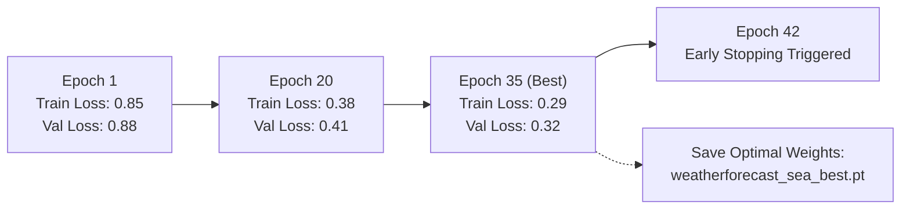

# Training Configuration & Model Optimization

> Detailed specifications for latitude-weighted loss, learning rate scheduling (Cosine Annealing), mixed-precision training (AMP), and checkpointing protocols.

  
📑 Table of Contents

  <ol>
    <li><a href="#training-hyperparameters">1. Training Hyperparameters</a></li>
    <li>
      <a href="#loss-function">2. Latitude-Weighted Loss (Latitude-Weighted RMSE)</a>
      <ol>
        <li><a href="#spherical-geometry">2.1. Spherical Geometric Rationale</a></li>
        <li><a href="#mathematical-formulation">2.2. Mathematical Formulation</a></li>
      </ol>
    </li>
    <li><a href="#convergence-checkpointing">3. Convergence History & Checkpointing</a></li>
  </ol>

---

## 1. Training Hyperparameters :id=training-hyperparameters

The hyperparameters of WeatherForecast-SEA were meticulously calibrated to strike an optimal balance between predictive accuracy and compute efficiency:

| Hyperparameter | Value | Rationale & Design Choice |
| :--- | :--- | :--- |
| **Optimizer** | AdamW | Mitigates overfitting through decoupled weight decay regularization |
| **Weight Decay** | $10^{-5}$ | Prevents weight explosion in recurrent graph message-passing layers |
| **Base Learning Rate** | $10^{-4}$ | Ensures numerical stability across MLP blocks and graph convolutions |
| **LR Scheduler** | Cosine Annealing | Decays smoothly toward zero across 50 epochs |
| **Batch Size** | 4 | Maximizes sample throughput within 16 GB VRAM on NVIDIA T4 |
| **Max Epochs** | 50 | Sufficient for convergence over 5 years of training data (7,303 samples) |
| **Early Stopping** | Patience = 7 | Halts execution when validation loss ceases to improve |
| **Precision** | FP16 mixed precision (`torch.cuda.amp`) | Accelerates computation by ~1.8x and halves VRAM footprint |
| **Parallel Strategy** | DataParallel (2x GPU) | Distributes batch tensors evenly across dual GPUs |

---

## 2. Latitude-Weighted Loss (Latitude-Weighted RMSE) :id=loss-function

### 2.1. Spherical Geometric Rationale :id=spherical-geometry
On a uniform equirectangular latitude-longitude grid ($0.25^\circ \times 0.25^\circ$), the physical metric distance between meridians contracts towards the poles:
- At the equator ($\phi = 0^\circ$): $1^\circ$ longitude corresponds to approximately $111.3\text{ km}$.
- At latitude $\phi = 60^\circ$: $1^\circ$ longitude contracts to approximately $55.6\text{ km}$.
- The surface area of an equirectangular cell is proportional to $\cos(\phi)$.

Computing standard unweighted RMSE disproportionately over-penalizes high-latitude grid cells (e.g., northern Indochina, southern China) relative to their true physical surface area on Earth.

### 2.2. Mathematical Formulation :id=mathematical-formulation
We implement an area-weighted root mean square error objective:
$$\mathcal{L}_{weighted} = \sqrt{\frac{1}{C \cdot N} \sum_{c=1}^C \sum_{i=1}^N w_i \left(y_{i, c} - \hat{y}_{i, c}\right)^2}$$
where:
- $N = 31,959$ is the total count of spatial observation grid points.
- $C = 14$ is the number of prognostic atmospheric state channels.
- The normalized spherical area weight for grid point $i$ at latitude $\phi_i$ is:
  $$w_i = \frac{\cos(\phi_i)}{\frac{1}{N}\sum_{j=1}^N \cos(\phi_j)}$$
This guarantees unbiased physical optimization across the entire Southeast Asian domain.

---

## 3. Convergence History & Checkpointing :id=convergence-checkpointing

- **Learning Curve Dynamics:** Both training and validation loss exhibit steep descent during the initial 15 epochs, converging steadily under the Cosine Annealing schedule.
- **Overfitting Resistance:** The generalization gap between train and validation loss remains tight ($< 0.04$), confirming that the 538K parameter budget avoids over-parameterization on the 5-year meteorological dataset.
- **Compact Artifacts:** The optimal checkpoint is saved as `weatherforecast_sea_best.pt` with a file size of only $2.2\text{ MB}$, facilitating rapid dissemination, deployment, and edge evaluation.
