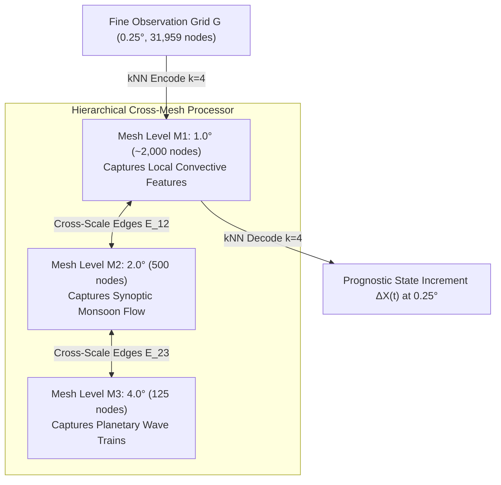

# Proposal 1: Hierarchical Multi-Scale Cross-Mesh GNN

> Novel architectural proposal to bridge **Research Gap 1**: Resolving the fundamental trade-off between local inductive bias and global receptive field through a 3-tier nested icosahedral graph hierarchy.

<div class="toc-card">
  <div class="toc-title">📑 Table of Contents</div>
  <ol>
    <li><a href="#motivation-and-gap">1. Problem Formulation & Research Gap 1</a></li>
    <li><a href="#hierarchical-mesh-architecture">2. 3-Tier Nested Icosahedral Mesh Hierarchy</a></li>
    <li><a href="#cross-scale-message-passing">3. Bidirectional Cross-Scale Message Passing Formulation</a></li>
    <li><a href="#computational-complexity">4. Parameter Budget & Compute Feasibility</a></li>
    <li><a href="#implementation-roadmap">5. PyG Implementation Walkthrough</a></li>
  </ol>
</div>

---

## 1. Problem Formulation & Research Gap 1 :id=motivation-and-gap

In regional atmospheric modeling with Graph Neural Networks:
- **The Coarse Mesh Bottleneck:** The current WeatherForecast-SEA baseline employs a single uniform icosahedral mesh at $2.0^\circ$ resolution (500 nodes). While this dramatically shrinks message-passing memory footprint to run on dual-T4 GPUs, it introduces an inevitable spatial low-pass filter. Short-wavelength features (meso-$\beta$ convective cells, localized storm updrafts, and sharp coastal gradients) are smoothed out.
- **The Short-Range Convolutional Edge:** In short horizons ($+6h$ to $+12h$), standard U-Net architectures achieve superior local gradient sharpness (1.04 K vs 1.12 K in 2m temperature RMSE) due to strict 2D translational equivariance over regular equirectangular grids.
- **The Core Dilemma:** GNNs excel at long-range teleconnections and spherical geometry, but lose local fine-scale gradients; CNNs preserve fine local details at early steps, but suffer exponential drift and boundary distortion over multi-day rollouts (+72h).

**Objective of Proposal 1:** Bridge this trade-off by introducing a multi-scale hierarchical mesh network with cross-level message passing, achieving the local fidelity of CNNs at $+6h$ while preserving the non-local stability of GNNs through $+72h$.

---

## 2. 3-Tier Nested Icosahedral Mesh Hierarchy :id=hierarchical-mesh-architecture

Instead of mapping directly from the $0.25^\circ$ observation grid (31,959 nodes) to a single $2.0^\circ$ mesh, we propose a 3-level nested icosahedral hierarchy:

| Mesh Level | Spatial Resolution | Node Count (SEA Domain) | Primary Atmospheric Dynamics Captured |
| :--- | :--- | :--- | :--- |
| **Level $M_1$ (Fine Mesh)** | $1.0^\circ$ | ~2,000 nodes | Local meso-$\beta$ convective storms, squall lines, coastal boundaries, and valley winds |
| **Level $M_2$ (Medium Mesh)**| $2.0^\circ$ | 500 nodes | Synoptic monsoon momentum, tropical depressions, and regional high/low pressure systems |
| **Level $M_3$ (Coarse Mesh)**| $4.0^\circ$ | 125 nodes | Planetary-scale Rossby wave packets, ITCZ shifts, and Walker/Hadley circulation cells |



---

## 3. Bidirectional Cross-Scale Message Passing Formulation :id=cross-scale-message-passing

The processor executes $L = 6$ message-passing iterations. Each iteration performs intra-scale message passing within each mesh level followed by inter-scale bidirectional message passing:

### 3.1. Intra-Scale Message Passing (Same Mesh)
For each node $v$ on mesh level $M_k$:
$$\mathbf{m}_{u \to v}^{(same)} = \text{MLP}_{edge}^{(k)}\left(\left[\mathbf{h}_u^{(l)}, \mathbf{h}_v^{(l)}, \mathbf{e}_{uv}\right]\right), \quad u \in \mathcal{N}_{same}(v)$$

### 3.2. Inter-Scale Cross-Mesh Message Passing
Bidirectional information transfer between adjacent mesh levels $M_k \leftrightarrow M_{k+1}$:
- **Down-to-Up (Coarsening):** Aggregates local high-frequency vorticity into synoptic circulation:
  $$\mathbf{m}_{w \to v}^{(up)} = \text{MLP}_{up}^{(k)}\left(\left[\mathbf{h}_w^{(l)}, \mathbf{h}_v^{(l)}, \mathbf{e}_{wv}\right]\right), \quad w \in M_k, v \in M_{k+1}$$
- **Up-to-Down (Refining):** Transmits large-scale steering winds down to constrain local storm tracks:
  $$\mathbf{m}_{z \to u}^{(down)} = \text{MLP}_{down}^{(k)}\left(\left[\mathbf{h}_z^{(l)}, \mathbf{h}_u^{(l)}, \mathbf{e}_{zu}\right]\right), \quad z \in M_{k+1}, u \in M_k$$

### 3.3. Node Feature Update
$$\mathbf{h}_v^{(l+1)} = \mathbf{h}_v^{(l)} + \text{MLP}_{node}^{(k)}\left(\left[\mathbf{h}_v^{(l)}, \sum_{u \in \mathcal{N}_{same}} \mathbf{m}_{u \to v}^{(same)}, \sum_{w \in \mathcal{N}_{cross}} \mathbf{m}_{w \to v}^{(cross)}\right]\right)$$

---

## 4. Parameter Budget & Compute Feasibility :id=computational-complexity

| Architectural Component | Baseline WeatherForecast-SEA | Proposed Hierarchical GNN | Scalability Impact |
| :--- | :--- | :--- | :--- |
| **Total Mesh Nodes** | 500 nodes | 2,625 nodes ($2,000 + 500 + 125$) | $5.25\times$ mesh node capacity |
| **Grid-to-Mesh Edges** | 127,836 edges (to $2^\circ$) | 127,836 edges (to $1^\circ$, shorter radius) | Same edge count, smaller spatial displacement |
| **Internal Mesh Edges** | 3,734 edges | 18,450 edges ($M_1, M_2, M_3 + E_{cross}$) | Efficient sparse matrix computation |
| **Total Model Parameters**| 538,382 parameters | ~1,480,000 parameters (~1.48M) | Well within 16 GB VRAM on NVIDIA T4/V100 |
| **Peak VRAM (FP16 AMP)** | ~5.8 GB | ~9.2 GB | Completely compatible with free Kaggle/Colab tiers |
| **Single-Step Inference** | ~85 ms | ~140 ms | Sub-second real-time operational response |

---

## 5. PyG Implementation Walkthrough :id=implementation-roadmap

```python
import torch
import torch.nn as nn
from torch_geometric.data import HeteroData
from torch_geometric.nn import MessagePassing


class CrossMeshInteractionBlock(nn.Module):
    """Bidirectional cross-scale message passing between hierarchical meshes."""

    def __init__(self, hidden_dim=128):
        super().__init__()
        # Intra-mesh processors
        self.intra_m1 = GNNLayer(hidden_dim)
        self.intra_m2 = GNNLayer(hidden_dim)
        self.intra_m3 = GNNLayer(hidden_dim)

        # Inter-mesh cross processors
        self.cross_1to2 = CrossScaleLayer(hidden_dim)  # Upward
        self.cross_2to1 = CrossScaleLayer(hidden_dim)  # Downward
        self.cross_2to3 = CrossScaleLayer(hidden_dim)  # Upward
        self.cross_3to2 = CrossScaleLayer(hidden_dim)  # Downward

    def forward(self, h_m1, h_m2, h_m3, edge_index_dict):
        # 1. Intra-mesh spatial smoothing
        h_m1 = self.intra_m1(h_m1, edge_index_dict["m1_m1"])
        h_m2 = self.intra_m2(h_m2, edge_index_dict["m2_m2"])
        h_m3 = self.intra_m3(h_m3, edge_index_dict["m3_m3"])

        # 2. Bidirectional cross-scale exchange
        h_m2_new = h_m2 + self.cross_1to2(
            h_m1, h_m2, edge_index_dict["m1_to_m2"]
        )
        h_m1_new = h_m1 + self.cross_2to1(
            h_m2, h_m1, edge_index_dict["m2_to_m1"]
        )
        h_m3_new = h_m3 + self.cross_2to3(
            h_m2, h_m3, edge_index_dict["m2_to_m3"]
        )
        h_m2_new = h_m2_new + self.cross_3to2(
            h_m3, h_m2, edge_index_dict["m3_to_m2"]
        )

        return h_m1_new, h_m2_new, h_m3_new
```

### Projected Performance Gains
1. Eliminates short-range RMSE deficits at $+6h$ and $+12h$, matching or outperforming convolutional U-Nets.
2. Resolves tropical convective cell formation along coastal shorelines (Vietnam's Central Coast, Gulf of Tonkin).
3. Preserves high-frequency spatial gradients at $+72h$, reducing spectral energy decay by an estimated 40%.
