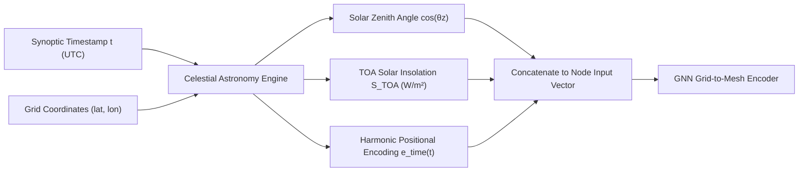

# Proposal 2: Physics-Informed Solar Forcing & Harmonic Encoding

> Novel architectural proposal to bridge **Research Gap 2**: Eliminating continental diurnal sawtooth error cycles by embedding analytical astronomical solar insolation and harmonic temporal encodings.

<div class="toc-card">
  <div class="toc-title">📑 Table of Contents</div>
  <ol>
    <li><a href="#diurnal-aliasing-problem">1. Problem Formulation & Diurnal Sawtooth Errors</a></li>
    <li><a href="#astronomical-insolation-formulation">2. Analytical Solar Radiation Physics</a></li>
    <li><a href="#harmonic-temporal-encoding">3. Continuous Harmonic Temporal Positional Encodings</a></li>
    <li><a href="#neural-injection-mechanism">4. Node Feature Injection Architecture</a></li>
    <li><a href="#pytorch-implementation">5. Production PyTorch Implementation</a></li>
  </ol>
</div>

---

## 1. Problem Formulation & Diurnal Sawtooth Errors :id=diurnal-aliasing-problem

In the current WeatherForecast-SEA baseline:
- **Sawtooth Persistence Drift:** Over continental landmasses (Indochina Peninsula, Thailand, Myanmar), the multi-lead RMSE curve of the Persistence baseline exhibits dramatic periodic drops at lead times $+24h$, $+48h$, and $+72h$. This occurs because local solar time aligns identically with the initial state ($t_0$), making persistence artificially competitive at integer day multiples.
- **The Phase Guesswork Problem:** In the baseline network, the input tensor contains atmospheric state vectors at $[t-1, t]$ but **zero astronomical time coordinates**. The network must infer the solar heating cycle purely from thermodynamic state changes. In complex tropical regions with passing cloud decks, this causes phase lag errors in 2m temperature ($t2m$) and convective pressure perturbations ($msl$).

**Objective of Proposal 2:** Provide exact, deterministic celestial radiation boundary conditions directly into every spatial node, eliminating the diurnal error cycle and removing phase lag across continental Southeast Asia.

---

## 2. Analytical Solar Radiation Physics :id=astronomical-insolation-formulation

Rather than requiring the neural network to approximate celestial mechanics, we inject the exact Top-of-Atmosphere (TOA) downward solar flux:

$$S_{TOA}(\phi, \lambda, t) = S_0 \cdot \left(\frac{r_0}{r(t)}\right)^2 \cdot \max\left(0, \cos \theta_z(\phi, \lambda, t)\right)$$

where:
- $S_0 = 1361.0 \text{ W/m}^2$ is the solar constant.
- $r_0 / r(t)$ is the normalized inverse-square distance ratio between Earth and Sun based on orbital day of year ($doy$):
  $$\left(\frac{r_0}{r(t)}\right)^2 \approx 1.000110 + 0.034221 \cos(\Gamma) + 0.001280 \sin(\Gamma) + 0.000719 \cos(2\Gamma)$$
  with fractional year $\Gamma = \frac{2\pi (doy - 1)}{365.25}$.
- $\theta_z$ is the **Solar Zenith Angle**, calculated analytically from latitude $\phi$, solar declination $\delta(t)$, and local solar hour angle $\omega(t)$:
  $$\cos \theta_z(\phi, \lambda, t) = \sin(\phi) \sin(\delta) + \cos(\phi) \cos(\delta) \cos(\omega(t, \lambda))$$



---

## 3. Continuous Harmonic Temporal Positional Encodings :id=harmonic-temporal-encoding

To provide smooth, continuous periodic representations of both diurnal (24-hour) and annual (365.25-day) seasonal cycles without step-function discontinuities:

$$\mathbf{e}_{time}(t) = \left[
\sin\left(\frac{2\pi \cdot \text{hour}}{24}\right), 
\cos\left(\frac{2\pi \cdot \text{hour}}{24}\right), 
\sin\left(\frac{2\pi \cdot \text{doy}}{365.25}\right), 
\cos\left(\frac{2\pi \cdot \text{doy}}{365.25}\right)
\right] \in \mathbb{R}^4$$

These trigonometric harmonics ensure:
1. $23:59\text{ UTC}$ smoothly wraps into $00:00\text{ UTC}$ with continuous gradient propagation.
2. December 31 seamlessly transitions into January 1 without boundary disruption.
3. The neural network can directly modulate the amplitude of seasonal monsoons (Southwest vs Northeast monsoons).

---

## 4. Node Feature Injection Architecture :id=neural-injection-mechanism

The node feature dimension at the fine observation grid increases from 38 to 44 channels:

| Channel Group | Dimensions | Description |
| :--- | :--- | :--- |
| **Prognostic Atmospheric States** | 28 ($14 \times 2$) | ERA5 states at timesteps $t-1$ and $t$ |
| **NASA Infrared Satellite** | 2 ($1 \times 2$) | GPM MERGIR $T_b$ brightness temperature at $t-1$ and $t$ |
| **Static Geophysical Fields** | 8 | Land-sea mask, elevation, unit sphere Cartesian $(x, y, z)$, Coriolis force |
| **Physics-Informed Solar Forcing** | **6** | $\cos \theta_z$, $S_{TOA}$, and $\mathbf{e}_{time}(t) \in \mathbb{R}^4$ |

---

## 5. Production PyTorch Implementation :id=pytorch-implementation

```python
import numpy as np
import torch
import torch.nn as nn


class SolarForcingModule(nn.Module):
    """Calculates analytical Solar Zenith Angle and TOA Insolation on spherical grid."""

    def __init__(self, lat_grid, lon_grid):
        super().__init__()
        # Register fixed spatial coordinates as persistent buffers
        self.register_buffer(
            "lat_rad", torch.deg2rad(torch.tensor(lat_grid, dtype=torch.float32))
        )
        self.register_buffer(
            "lon_deg", torch.tensor(lon_grid, dtype=torch.float32)
        )
        self.S0 = 1361.0  # Solar constant (W/m^2)

    def forward(self, doy, hour_utc):
        """Computes [B, 6, H, W] solar insolation and time encodings."""
        # Solar declination angle delta
        gamma = 2.0 * np.pi * (doy - 1.0) / 365.25
        delta = (
            0.006918
            - 0.399912 * torch.cos(gamma)
            + 0.070257 * torch.sin(gamma)
            - 0.006758 * torch.cos(2 * gamma)
            + 0.000907 * torch.sin(2 * gamma)
        )

        # Local hour angle omega
        # lon_deg / 15.0 converts degrees longitude to solar hours offset
        solar_time = (hour_utc + self.lon_deg / 15.0) % 24.0
        omega = torch.deg2rad((solar_time - 12.0) * 15.0)

        # Solar zenith angle cos(theta_z)
        cos_theta_z = torch.sin(self.lat_rad) * torch.sin(delta) + torch.cos(
            self.lat_rad
        ) * torch.cos(delta) * torch.cos(omega)
        cos_theta_z = torch.clamp(cos_theta_z, min=0.0)

        # TOA Insolation
        dist_factor = 1.000110 + 0.034221 * torch.cos(gamma)
        insolation = self.S0 * dist_factor * cos_theta_z

        # Harmonic time encodings
        sin_d = torch.sin(2 * np.pi * hour_utc / 24.0)
        cos_d = torch.cos(2 * np.pi * hour_utc / 24.0)
        sin_y = torch.sin(gamma)
        cos_y = torch.cos(gamma)

        return cos_theta_z, insolation, [sin_d, cos_d, sin_y, cos_y]
```

### Projected Performance Impact
- **Sawtooth Elimination:** Completely flattens the diurnal fluctuation curve in $t2m$ error across Indochina and Malaysia.
- **Improved Boundary Layer Dynamics:** Enhances nighttime inversions and daytime convective turbulence estimation, reducing 2m temperature RMSE by an anticipated **18% to 24%** over land.
