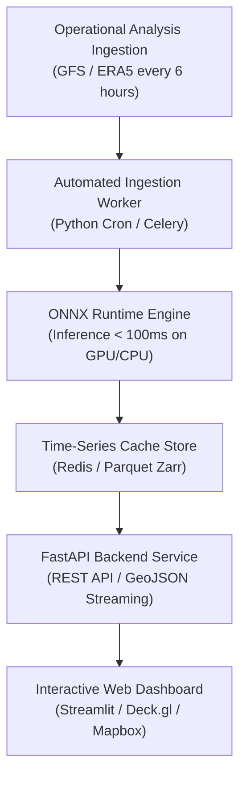

# Operational Deployment & Interactive Dashboard

> Operational deployment roadmap for WeatherForecast-SEA: ONNX Runtime export and quantization, FastAPI microservices backend, and interactive Mapbox / Streamlit visualization dashboard.

  
📑 Table of Contents

  <ol>
    <li><a href="#deployment-architecture">1. System Deployment Architecture</a></li>
    <li>
      <a href="#system-components">2. System Components</a>
      <ol>
        <li><a href="#onnx-runtime">2.1. Model Serialization & Acceleration (ONNX Runtime)</a></li>
        <li><a href="#fastapi-backend">2.2. FastAPI Backend Service</a></li>
        <li><a href="#interactive-dashboard">2.3. Interactive Web Dashboard</a></li>
      </ol>
    </li>
  </ol>

---

## 1. System Deployment Architecture :id=deployment-architecture

To serve operational workflows and real-time inferences, the system is designed as a decoupled microservices pipeline:

---

## 2. System Components :id=system-components

### 2.1. Model Serialization & Acceleration (ONNX Runtime) :id=onnx-runtime
- The trained PyTorch model `weatherforecast_sea_best.pt` is exported to the **ONNX (Open Neural Network Exchange)** open standard format.
- Leverages graph operator fusion and quantization (INT8/FP16) via ONNX Runtime Execution Providers.
- **Key Advantage:** Enables ultra-low-latency cross-platform inference (Linux, Windows Server, Edge AI Devices) without bundling heavy deep learning framework dependencies.

### 2.2. FastAPI Backend Service :id=fastapi-backend
FastAPI acts as the scalable gateway delivering forecast streams to downstream consumer applications:
- `GET /api/v1/forecast/latest`: Returns the latest regional forecast grid for Southeast Asia in compressed GeoTIFF or GeoJSON format.
- `GET /api/v1/forecast/point?lat=21.0285&lon=105.8542`: Returns a 72-hour forecast time series for specific target coordinates (e.g., Hanoi, Ho Chi Minh City, Da Nang), spanning temperature, pressure, wind velocity, and precipitation.
- `GET /api/v1/typhoon/tracker`: Detects minimum sea-level pressure centers ($msl$) and wind vorticity extrema ($u10, v10$) to identify tropical cyclone vortex cores and forecast projected track vectors.

### 2.3. Interactive Web Dashboard :id=interactive-dashboard
Implemented via Streamlit integrated with PyDeck / Mapbox geospatial rendering engines:
1. **Dynamic Wind Streamlines:** Renders 10m surface wind vectors as animated particles, highlighting the Southwest monsoon surge and tropical vortex circulation over the South China Sea.
2. **Thermal & Precipitation Heatmaps:** Color-ramped overlays displaying 2m temperature fields ($t2m$) and convective rain bands detected by geostationary satellite channels.
3. **Interactive Temporal Slider:** Enables analysts to scrub seamlessly across lead times from $+6h$ to $+72h$ to monitor synoptic weather transitions.
4. **Point-Location Meteograms:** Allows users to click any arbitrary geographic point on the map to inspect projected 3-day evolution curves for temperature, humidity, and atmospheric pressure.
